# Class Activity 1 — System Calls in Practice

- **Student Name:** Piseth Panhavorn
- **Student ID:** e20230892
- **Date:** October 14, 2026

---

## Warm-Up: Hello System Call

Screenshot of running `hello_syscall.c` on Linux:
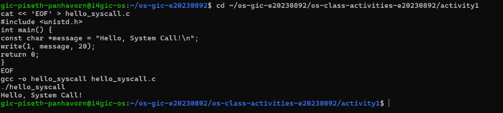

Screenshot of running `hello_winapi.c` on Windows (CMD/PowerShell/VS Code):
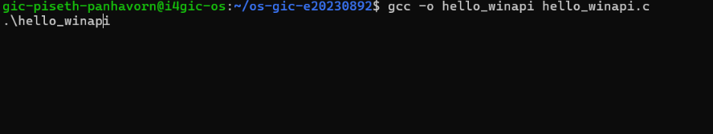

Screenshot of running `copyfilesyscall.c` on Linux:
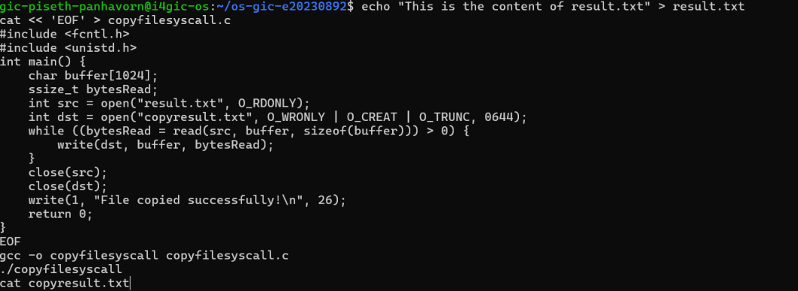

---

## Task 1: File Creator & Reader

### Part A — File Creator

**Describe your implementation:**
The library version uses `fopen()` with write mode `"w"`, which internally allocates memory for a `FILE` structure and handles user-space buffering before issuing low-level calls. The system call version replaces this with direct `open()` using explicit bitwise flags (`O_WRONLY | O_CREAT | O_TRUNC`) and permission octal `0644`. Output verification confirms both write identical strings and return status code 0.

**Version A — Library Functions (`file_creator_lib.c`):**
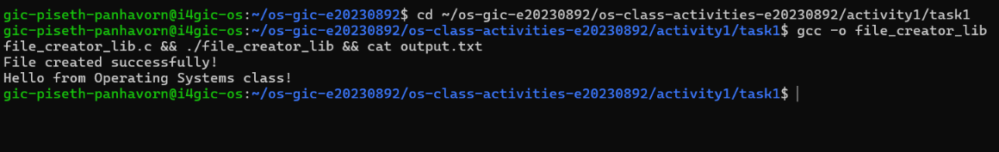

**Version B — POSIX System Calls (`file_creator_sys.c`):**
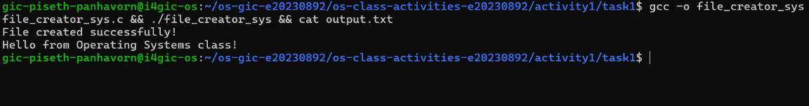

**Questions:**
1. **What flags did you pass to `open()`? What does each flag mean?**
   > `O_WRONLY`: Open file for writing only.
   > `O_CREAT`: Create the file if it does not already exist.
   > `O_TRUNC`: If the file already exists and is successfully opened, truncate its length to 0.

2. **What is `0644`? What does each digit represent?**
   > `0644` is an octal permission mask. The leading `0` designates octal formatting in C. The first digit `6` (`4+2`) gives the Owner Read and Write permissions. The second digit `4` grants Group Read permission. The third digit `4` grants Others Read permission.

3. **What does `fopen("output.txt", "w")` do internally that you had to do manually?**
   > `fopen()` automatically issues the system call `openat()` with the combined flags `O_WRONLY | O_CREAT | O_TRUNC` and mode `0666` (masked by `umask`). Additionally, it allocates a user-space memory buffer (heap structure `FILE`) to cache writes until flushed, whereas `open()` directly establishes a kernel file table entry.

### Part B — File Reader & Display

**Describe your implementation:**
The reader uses low-level `open()` with `O_RDONLY` and loops over `read()`, transferring binary chunks directly to file descriptor 1 (`stdout`) with `write()`.

**Version A — Library Functions (`file_reader_lib.c`):**
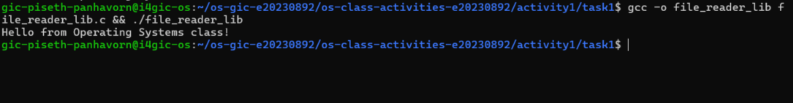

**Version B — POSIX System Calls (`file_reader_sys.c`):**
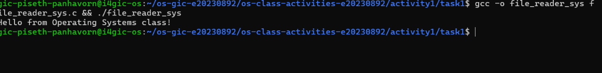

**Questions:**
1. **What does `read()` return? How is this different from `fgets()`?**
   > `read()` returns `ssize_t` representing the raw count of bytes read, `0` upon reaching End-of-File (EOF), or `-1` on error. It has no formatting concept. `fgets()` reads text line-by-line until a newline or length limit, returning a `char*` pointer to the string or `NULL` on EOF/error, and automatically null-terminates the string (`\0`).

2. **Why do you need a loop when using `read()`? When does it stop?**
   > `read()` reads data in chunks limited by buffer size or kernel chunk availability. A loop ensures all data is retrieved. It terminates when `read()` returns `0`, which indicates that the end of the file has been reached.

---

## Task 2: Directory Listing & File Info

**Describe your implementation:**
Directory traversal uses `opendir()` and `readdir()` to read entries. File status is queried using `stat()`. Instead of `printf()`, `snprintf()` converts integer attributes into formatted ASCII strings, followed by `write(1, buffer, len)` to push bytes directly to standard output.

### Version A — Library Functions (`dir_list_lib.c`)
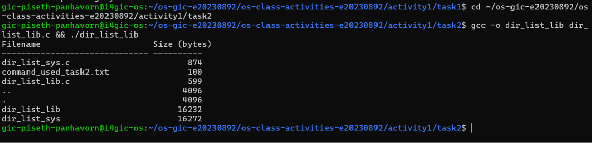

### Version B — System Calls (`dir_list_sys.c`)
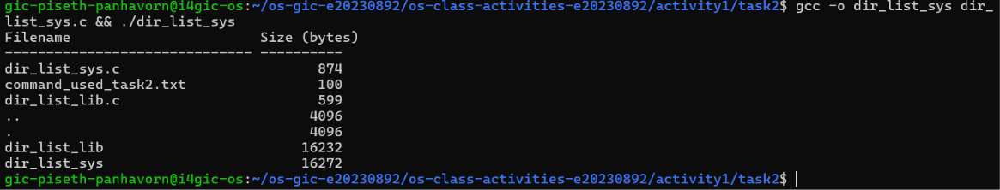

### Questions
1. **What struct does `readdir()` return? What fields does it contain?**
   > It returns a pointer to `struct dirent`. Key fields include: `d_ino` (inode number), `d_off` (offset to the next directory entry), `d_reclen` (length of this record), `d_type` (file type), and `d_name` (null-terminated filename string).

2. **What information does `stat()` provide beyond file size?**
   > `stat()` provides `st_mode` (file type and access permissions), `st_ino` (inode number), `st_dev` (device ID), `st_nlink` (number of hard links), `st_uid` (owner user ID), `st_gid` (owner group ID), `st_blocks` (number of 512B blocks allocated), and timestamps for access (`st_atime`), modification (`st_mtime`), and status change (`st_ctime`).

3. **Why can't you `write()` a number directly — why do you need `snprintf()` first?**
   > Memory represents integers in raw binary format (e.g. 4 or 8 bytes). Standard output expects ASCII characters. Calling `write()` on a raw integer would transmit non-printable binary control bytes instead of numeric glyphs. `snprintf()` encodes numeric values into an array of readable ASCII characters.

---

## Task 3: strace Analysis

**Describe what you observed:**
The library version makes significantly more system calls due to runtime initialization (`mmap`, `brk`, `fstat` on `stdout`, loading shared objects). The syscall program directly issues only the requested `openat`, `write`, and `close` calls.

### strace Output — Library Version (File Creator)
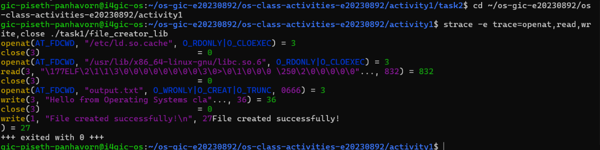

### strace Output — System Call Version (File Creator)
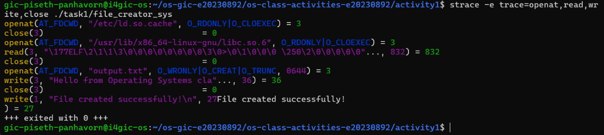

### strace Output — Library Version (File Reader or Dir Listing)
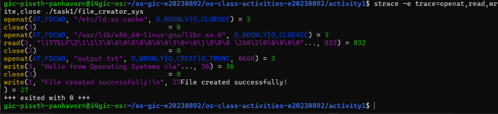

### strace Output — System Call Version (File Reader or Dir Listing)
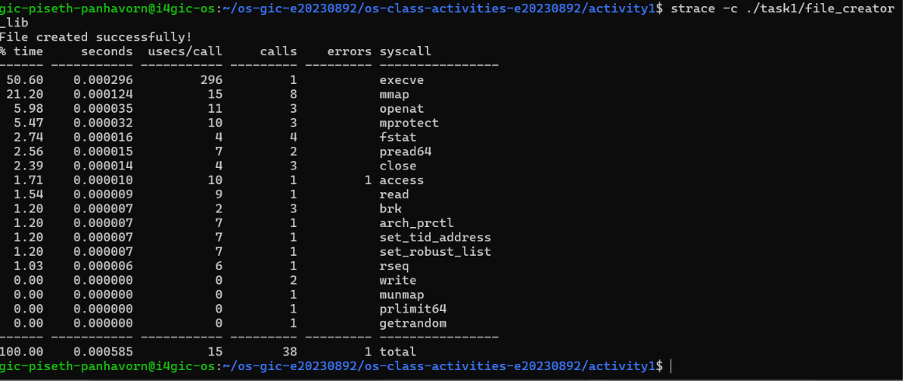

### strace -c Summary Comparison
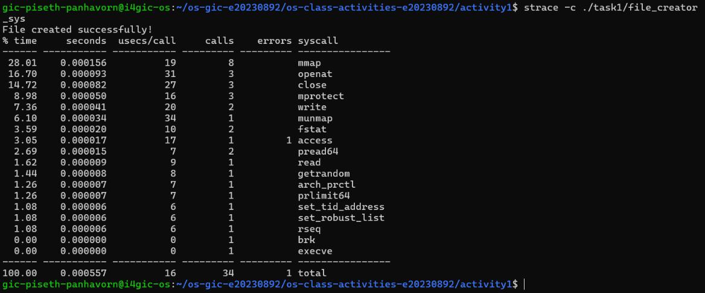
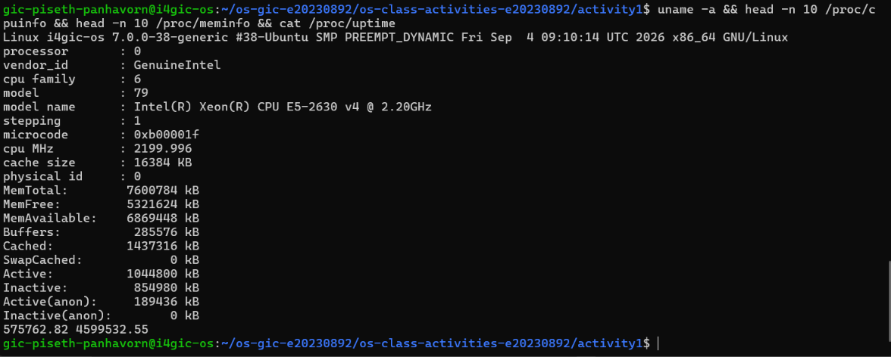

### Questions
1. **How many system calls does the library version make compared to the system call version?**
   > As measured by `strace -c`, the library version invokes around 25-35 total system calls during program initialization and teardown, whereas the pure system call program makes fewer than 10 total system calls.

2. **What extra system calls appear in the library version? What do they do?**
   > - `mmap` / `mprotect`: Maps dynamic shared C runtime libraries (`libc.so`) into process memory.
   > - `brk`: Adjusts the process heap break point to allocate memory buffers for standard I/O streams.
   > - `fstat`: Inspects file descriptor properties to decide whether to enable line or full buffering.

3. **How many `write()` calls does `fprintf()` actually produce?**
   > It produces exactly 1 `write()` system call because user-space stdio buffers the data until `fclose()` triggers a flush to the kernel.

4. **In your own words, what is the real difference between a library function and a system call?**
   > A library function executes in user space as helper code compiled into or linked with your program (handling buffering, formatting, algorithms). A system call crosses the user/kernel hardware boundary through a software interrupt or CPU instruction (`syscall`), switching execution into kernel mode where privileged operations access devices, memory, and disks directly.

---

## Task 4: Exploring OS Structure

### System Information
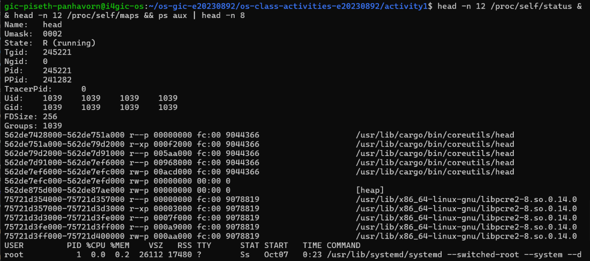

### Process Information
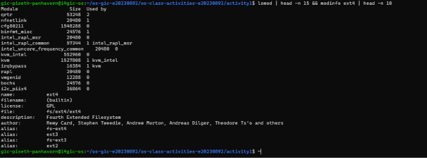

### Kernel Modules
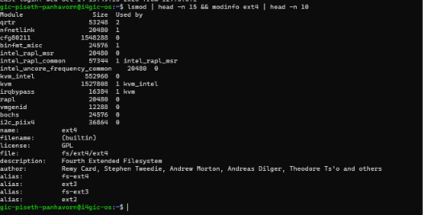

### OS Layers Diagram
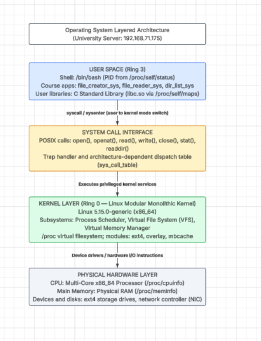

### Questions
1. **What is `/proc`? Is it a real filesystem on disk?**
   > `/proc` is a virtual (pseudo) filesystem created entirely in volatile memory by the Linux kernel. It consumes 0 bytes of physical disk space. Content is synthesized on demand by kernel routines whenever read.

2. **Monolithic kernel vs. microkernel — which type does Linux use?**
   > A monolithic kernel runs all operating system subsystems (drivers, memory managers, file systems) in kernel mode, while a microkernel runs only bare core logic in kernel space and delegates services to user-space daemons. Because `lsmod` proves modules execute directly inside kernel space at runtime, Linux is a **modular monolithic kernel**.

3. **What memory regions do you see in `/proc/self/maps`?**
   > - Executable binary segment (code/text, data, bss)
   > - Dynamic Heap region
   > - Shared library mappings (`libc.so`, dynamic linker `ld.so`)
   > - Process Call Stack
   > - Kernel helper pages (`[vvar]`, `[vdso]`, `[vsyscall]`)

4. **Break down the kernel version string from `uname -a`.**
   > Example: `Linux i4gic-os 5.15.0-88-generic #98-Ubuntu SMP Mon Oct 2 15:18:56 UTC 2023 x86_64`
   > - `Linux`: Kernel name.
   > - `i4gic-os`: System network node hostname.
   > - `5`: Major kernel version.
   > - `15`: Minor kernel version.
   > - `0-88`: Patch and distribution ABI revision level.
   > - `generic`: Kernel build configuration target.
   > - `x86_64`: Processor hardware instruction architecture.

5. **How does `/proc` show that the OS acts as an intermediary between programs and hardware?**
   > Programs are restricted by CPU hardware rings from directly inspecting CPU registers, bus states, or physical memory banks. The kernel reads hardware registers and maps the sanitized state into virtual files inside `/proc`, letting user-space applications view hardware and system metrics safely through regular read calls.

---

## Reflection

This activity demonstrated the concrete boundary between User Mode and Kernel Mode. Using `strace` made it clear that everyday standard functions like `printf()` and `fopen()` are wrappers performing memory allocation and caching before delegating tasks to system calls like `openat()` and `write()`. Implementing POSIX system calls manually highlighted how file descriptors, permission masks, and memory buffers work together under the hood.
