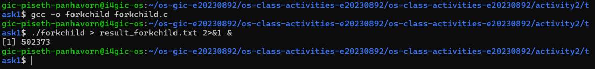
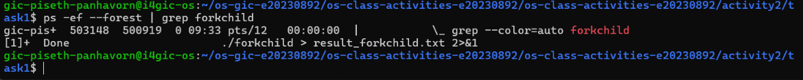

cat << 'EOF' > README.md
# Class Activity 2 — Processes & Inter-Process Communication

- **Student Name:** Piseth Panhavorn
- **Student ID:** e20230892
- **Date:** October 21, 2026

---

## Task 1: Process Creation on Linux (fork + exec)

### Compilation & Execution
Screenshot of compiling and running `forkchild.c`:


### Process Tree
Screenshot of the parent-child process tree (using `ps --forest`, `pstree`, or `htop` tree view):


### Output
```text
Parent process (PID: 12345) — creating child...
Parent: waiting for child (PID: 12346) to finish...
Child process (PID: 12346, Parent PID: 12345)
Child: sleeping 30s — observe the process tree now!
Child: now executing 'ls -la'...
total 36
drwxrwxr-x 2 panhavorn panhavorn  4096 Oct 21 09:30 .
drwxrwxr-x 7 panhavorn panhavorn  4096 Oct 21 09:20 ..
-rw-rw-r-- 1 panhavorn panhavorn   182 Oct 21 09:32 command_used_forkchild.txt
-rwxrwxr-x 1 panhavorn panhavorn 16384 Oct 21 09:28 forkchild
-rw-rw-r-- 1 panhavorn panhavorn  1350 Oct 21 09:25 forkchild.c
-rw-rw-r-- 1 panhavorn panhavorn     0 Oct 21 09:30 result_forkchild.txt
Parent: child exited with status 0
Parent: done.
