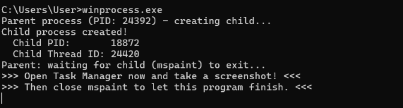
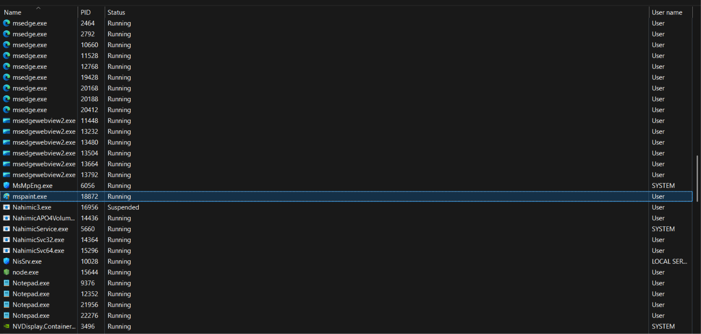
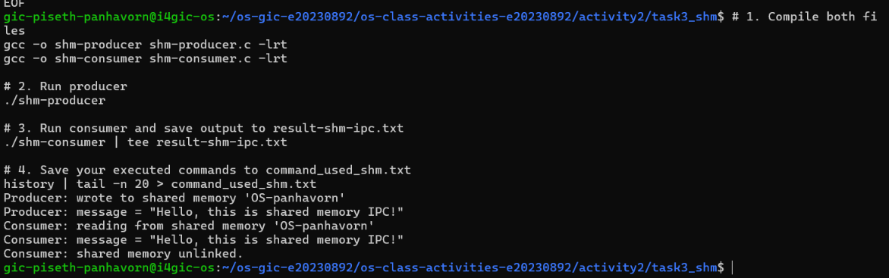
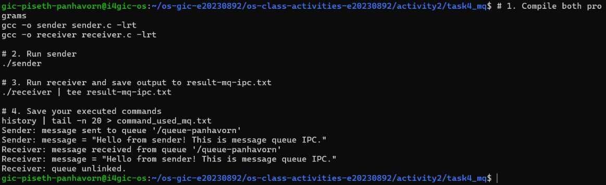

# Class Activity 2 — Processes & Inter-Process Communication

- **Student Name:** Piseth Panhavorn
- **Student ID:** e20230892
- **Date:** October 21, 2026

---

## Task 1: Process Creation on Linux (fork + exec)

### Compilation & Execution

Screenshot of compiling and running `forkchild.c`:


### Process Tree

Screenshot of the parent-child process tree (using `ps --forest`, `pstree`, or `htop` tree view):


### Output

```text
total 32
drwxrwxr-x 2 gic-piseth-panhavorn gic-piseth-panhavorn  4096 Oct 21 09:31 .
drwxrwxr-x 7 gic-piseth-panhavorn gic-piseth-panhavorn  4096 Oct 21 09:26 ..
-rwxrwxr-x 1 gic-piseth-panhavorn gic-piseth-panhavorn 16392 Oct 21 09:31 forkchild
-rw-rw-r-- 1 gic-piseth-panhavorn gic-piseth-panhavorn  1104 Oct 21 09:30 forkchild.c
-rw-rw-r-- 1 gic-piseth-panhavorn gic-piseth-panhavorn     0 Oct 21 09:31 result_forkchild.txt
Parent process (PID: 502373) — creating child...
Parent: waiting for child (PID: 502375) to finish...
Parent: child exited with status 0
Parent: done.
```

### Questions

1. **What does `fork()` return to the parent? What does it return to the child?**

   > - **To the parent process:** `fork()` returns the Process ID (PID) of the newly created child process (a positive non-zero integer, e.g., `502375`). If process creation fails, it returns `-1`.
   > - **To the child process:** `fork()` returns `0`. This return value allows the program logic to differentiate execution paths between parent (`pid > 0`) and child (`pid == 0`).

2. **What happens if you remove the `waitpid()` call? Why might the output look different?**

   > If `waitpid()` is removed:
   > - The parent process will not pause to wait for the child to finish. Both parent and child processes will execute concurrently and independently.
   > - The parent process might finish and exit before the child finishes its 30-second sleep and executes `ls -la`. In this scenario, the child becomes an **orphan process** and is adopted by the system's init/systemd process (PID 1).
   > - If the child finishes first without the parent collecting its exit status, the child briefly becomes a **zombie process** (`<defunct>`).
   > - The console output will become non-deterministic, with "Parent: done." appearing before the child finishes.

3. **What does `execlp()` do? Why don't we see "execlp failed" when it succeeds?**

   > - `execlp()` replaces the current process image (code segment, data, stack, and heap) with a new executable image (in this case, `/bin/ls`) searched from the system `PATH`.
   > - When `execlp()` succeeds, the original program's execution context is completely replaced by the new program, so execution never returns to the calling code. Therefore, lines following `execlp()`, including `perror("execlp")`, are only reached if `execlp()` fails to execute.

4. **Draw the process tree for your program (parent → child). Include PIDs from your output.**

   > ```text
   > bash (PID: 500919)
   >   │
   >   └── forkchild [Parent] (PID: 502373)
   >         │
   >         └── forkchild -> ls -la [Child] (PID: 502375)
   > ```

5. **Which command did you use to view the process tree (`ps --forest`, `pstree`, or `htop`)? What information does each column show?**

   > The command used was: `ps -ef --forest | grep forkchild`
   >
   > Column meanings in `ps -ef`:
   > - **`UID`**: User identity executing the process (`gic-piseth-panhavorn`).
   > - **`PID`**: Unique Process ID assigned by the OS kernel.
   > - **`PPID`**: Parent Process ID (the ID of the process that spawned this process).
   > - **`C`**: CPU utilization factor used by the kernel scheduler.
   > - **`STIME`**: System start time of the process.
   > - **`TTY`**: Terminal device associated with the process (`pts/12`).
   > - **`TIME`**: Total cumulative CPU processing time used.
   > - **`CMD`**: Command name, arguments, and visual tree indentation (`\_`).

---

## Task 2: Process Creation on Windows

### Compilation & Execution

Screenshot of compiling and running `winprocess.c`:



### Task Manager Screenshots

Screenshot showing process tree in the **Processes** tab (mspaint nested under your program):


Screenshot showing PID and Parent PID in the **Details** tab:



### Questions

1. **What is the key difference between how Linux creates a process (`fork` + `exec`) and how Windows does it (`CreateProcess`)?**

   > - **Linux:** Uses a two-step model:
   >   1. `fork()` creates an exact duplicate clone of the calling process (using Copy-On-Write memory mapping).
   >   2. `exec()` (e.g., `execlp()`) then replaces the cloned process image with a new executable.
   > - **Windows:** Uses a single, unified API call `CreateProcess()`. It directly creates a brand new address space, loads the target executable (`mspaint.exe`), creates the initial thread, and begins execution without cloning the parent process.

2. **What does `WaitForSingleObject()` do? What is its Linux equivalent?**

   > - `WaitForSingleObject(pi.hProcess, INFINITE)` blocks the calling parent thread until the specified kernel object (the child process handle) transitions to a signaled state, which indicates the child process has terminated.
   > - Its Linux equivalent is `wait()` or `waitpid()`.

3. **Why do we need to call `CloseHandle()` at the end? What happens if we don't?**

   > - `CreateProcess()` allocates kernel handles for the process (`pi.hProcess`) and the primary thread (`pi.hThread`), incrementing their kernel reference counts.
   > - Calling `CloseHandle()` decrements these reference counts, signaling to Windows that the parent no longer needs kernel access to those objects.
   > - If `CloseHandle()` is not called, a **handle/resource leak** occurs. The Windows kernel cannot free the internal process and thread tracking descriptors even after the child process terminates until the parent process exits.

4. **In Task Manager, what was the PID of your parent program and the PID of mspaint? Do they match your program's output?**

   > - **Parent Program (`winprocess.exe`):** PID `24392`
   > - **Child Program (`mspaint.exe`):** PID `18872` (Child Thread ID: `24420`)
   > - **Task Manager Match:** Yes, in the Task Manager **Details** tab, `mspaint.exe` is explicitly displayed running under PID `18872`, which matches the program output exactly.

5. **Compare the Processes tab (tree view) and the Details tab (PID/PPID columns). Which view makes it easier to understand the parent-child relationship? Why?**

   > - The **Processes tab (tree view)** is significantly easier for visualizing parent-child relationships at a glance because child processes are nested and indented directly beneath their parent application node with expandable/collapsible drop-downs.
   > - The **Details tab** presents processes as a flat list sorted by name or PID. To identify parent-child relationships, one must inspect and manually correlate the numerical PID and PPID columns.

---

## Task 3: Shared Memory IPC

### Compilation & Execution

Screenshot of compiling and running `shm-producer` and `shm-consumer`:



### Output

```text
Consumer: reading from shared memory 'OS-panhavorn'
Consumer: message = "Hello, this is shared memory IPC!"
Consumer: shared memory unlinked.
```

### Questions

1. **What does `shm_open()` do? How is it different from `open()`?**

   > - `shm_open()` creates or opens a POSIX shared memory object and returns an integer file descriptor.
   > - Unlike standard `open()`, which opens or creates persistent files on a physical disk file system, `shm_open()` creates a memory-backed object in RAM (typically managed under `/dev/shm` in Linux), eliminating disk I/O overhead.

2. **What does `mmap()` do? Why is shared memory faster than other IPC methods?**

   > - `mmap()` maps the shared memory object referenced by the file descriptor directly into the calling process's virtual address space, returning a memory pointer that can be read or written just like normal memory buffers.
   > - Shared memory is the fastest IPC mechanism because once the mapping is created, data exchange occurs directly at memory bus speeds (RAM read/write). There is no kernel mediation or data copying between user space and kernel space (zero-copy architecture).

3. **Why must the shared memory name match between producer and consumer?**

   > The shared memory name (e.g., `'OS-panhavorn'`) serves as the global system identifier in the operating system's POSIX shared memory namespace. Both the producer and consumer must use the exact same name so that the OS resolves both calls to the same underlying shared memory segment.

4. **What does `shm_unlink()` do? What would happen if the consumer didn't call it?**

   > - `shm_unlink()` removes the shared memory object name from the system. Once all processes that mapped the object close their descriptors and unmap the memory, the kernel deallocates the segment.
   > - If `shm_unlink()` is never called, the shared memory segment persists in virtual memory (`/dev/shm`) even after all processes terminate, consuming system memory until manual removal or system reboot.

5. **If the consumer runs before the producer, what happens? Try it and describe the error.**

   > - Because `shm-consumer.c` opens the shared memory object with `O_RDONLY` without `O_CREAT`, it requires the shared memory object to already exist.
   > - If the consumer runs first, `shm_open()` fails, returning `-1`, and produces the following error:
   >   ```text
   >   shm_open: No such file or directory
   >   Hint: Did you run shm-producer first?
   >   ```
   > - The program then terminates immediately with `EXIT_FAILURE`.

---

## Task 4: Message Queue IPC

### Compilation & Execution

Screenshot of compiling and running `sender` and `receiver`:



### Output

```text
Receiver: message received from queue '/queue-panhavorn'
Receiver: message = "Hello from sender! This is message queue IPC."
Receiver: queue unlinked.
```

### Questions

1. **How is a message queue different from shared memory? When would you use one over the other?**

   > - **Differences:** Shared memory provides an unformatted, raw block of memory where applications must manually synchronize access (using semaphores/mutexes) to avoid race conditions. Message queues provide structured, discrete message passing with built-in kernel synchronization, message boundaries, and priority handling.
   > - **When to use:**
   >   - Use **Shared Memory** when transferring large amounts of data or where maximum throughput/minimum latency is critical (e.g., video frame sharing, high-frequency data buffers).
   >   - Use **Message Queues** when passing distinct messages/commands between processes, requiring queue-based buffering, asynchronous decoupled messaging, or priority-based message processing.

2. **Why does the queue name in `common.h` need to start with `/`?**

   > POSIX standards dictate that message queue names must begin with a leading forward slash (`/`) and contain no other slashes (e.g., `"/queue-panhavorn"`). This allows the OS to mount and identify the queue properly within the POSIX message queue virtual filesystem namespace (visible under `/dev/mqueue` on Linux).

3. **What does `mq_unlink()` do? What happens if neither the sender nor receiver calls it?**

   > - `mq_unlink()` removes the message queue name from the operating system. When all processes close their message queue descriptors, the kernel deallocates the queue and reclaims its resources.
   > - If neither process calls `mq_unlink()`, the message queue remains persistent in kernel memory (`/dev/mqueue`). Any remaining unread messages remain buffered, and future runs could read stale messages or fail to initialize proper queue attributes.

4. **What happens if you run the receiver before the sender?**

   > - Since `receiver.c` opens the queue with `O_RDONLY` without `O_CREAT`, it expects the queue to already exist.
   > - If the sender has not created the queue yet, `mq_open()` fails, returning `(mqd_t)-1`, printing:
   >   ```text
   >   mq_open: No such file or directory
   >   Hint: Did you run sender first?
   >   ```
   > - If the queue already existed but was empty, a blocking call to `mq_receive()` would pause and wait until a message is sent.

5. **Can multiple senders send to the same queue? Can multiple receivers read from the same queue?**

   > - **Yes to both:**
   >   - **Multiple senders:** Can concurrently open and post messages to the same queue. The kernel synchronizes insertions, ordering messages by priority and arrival time (FIFO within each priority level).
   >   - **Multiple receivers:** Can read from the same queue. Each message is delivered to exactly one receiver (competing consumers pattern), making it suitable for distributed worker pools.

---

## Reflection

In this activity, I gained hands-on experience with process lifecycle management and inter-process communication (IPC) across both Linux and Windows environments:

1. **Linux vs. Windows Process Creation:**
   The fundamental design philosophies of the two operating systems became very clear. Linux's two-step architecture—`fork()` to duplicate the current process address space followed by `exec()` to load a new binary—offers flexibility (allowing environment and descriptor manipulation between calls). In contrast, Windows takes a single-call approach with `CreateProcess()`, which requires explicit configuration parameters (`STARTUPINFO`, `PROCESS_INFORMATION`) and manages process and thread handles explicitly via the Win32 API.

2. **IPC Comparison (Shared Memory vs. Message Queues):**
   Working with POSIX IPC highlighted the trade-offs between shared memory and message queues:
   - **Shared Memory** is exceptionally fast due to direct memory mapping (`mmap`) without kernel mediation, but requires careful coordination to prevent data corruption.
   - **Message Queues** provide convenient, kernel-managed synchronization, message boundaries, and priority ordering, making them much simpler and safer for structured messaging.

Overall, I prefer **Message Queues** for general application IPC due to their built-in synchronization and safety, while reserving **Shared Memory** for performance-critical tasks involving large payloads.
