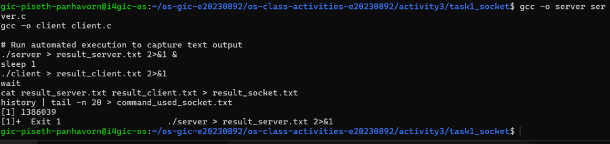
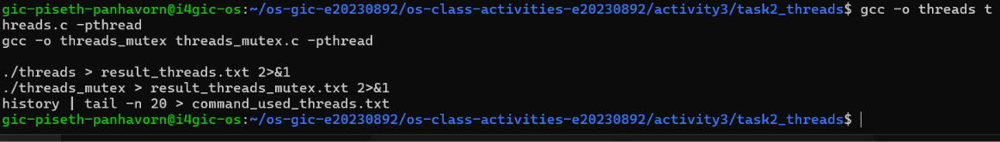
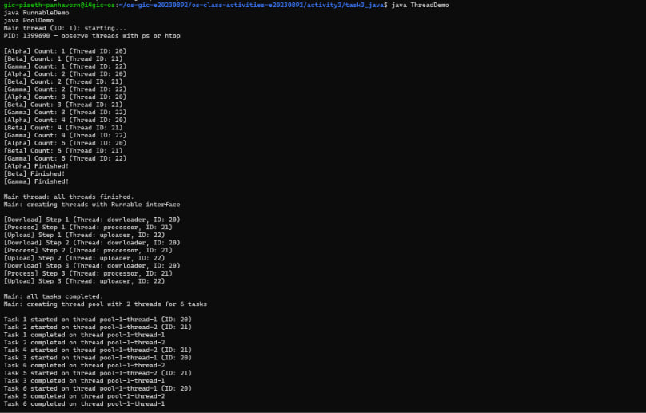
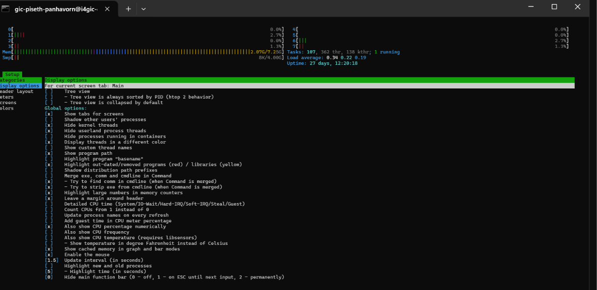
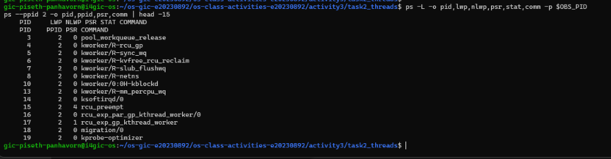
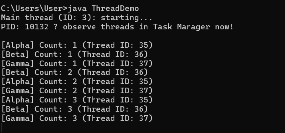

# Class Activity 3 — Socket Communication & Multithreading

- **Student Name:** Piseth Panhavorn
- **Student ID:** e20230892
- **Date:** November 4, 2026

---

## Task 1: TCP Socket Communication (C)

### Compilation & Execution

### Answers

1. **Role of `bind()` / Why client doesn't call it:**
   > _Your answer_

2. **What `accept()` returns:**
   > _Your answer_

3. **Starting client before server:**
   > _Your answer_

4. **What `htons()` does:**
   > _Your answer_

5. **Socket call sequence diagram:**
   > _Your diagram_

---

## Task 2: POSIX Threads (C)

### Output — Without Mutex (Race Condition)

### Output — With Mutex (Correct)

_(Include in the same screenshot or a separate one)_

### Answers

1. **What is a race condition?**
   > _Your answer_

2. **What does `pthread_mutex_lock()` do?**
   > _Your answer_

3. **Removing `pthread_join()`:**
   > _Your answer_

4. **Thread vs Process:**
   > _Your answer_

---

## Task 3: Java Multithreading

### ThreadDemo Output

### RunnableDemo Output

_(Include output or screenshot)_

### PoolDemo Output

_(Include output or screenshot)_

### Answers

1. **Thread vs Runnable:**
   > _Your answer_

2. **Pool size limiting concurrency:**
   > _Your answer_

3. **thread.join() in Java:**
   > _Your answer_

4. **ExecutorService advantages:**
   > _Your answer_

---

## Task 4: Observing Threads

### Linux — `ps -eLf` Output

_(Paste the relevant ps output here)_

### Linux — htop Thread View

### Linux — htop Kernel Threads (tree view, `kthreadd`)

### Linux — Kernel Threads (commands)

_(Paste the output of `ps -L ...` and `ps --ppid 2 ...` here)_

### Windows — Task Manager

### Answers

1. **LWP column meaning:**
   > _Your answer_

2. **/proc/PID/task/ count:**
   > _Your answer_

3. **Extra Java threads:**
   > _Your answer_

4. **Linux vs Windows thread viewing:**
   > _Your answer_

5. **kthreadd and three kernel threads:**
   > _Your answer_

6. **TID equal to PID, NLWP and cores:**
   > _Your answer_

7. **`H` and `K` in htop:**
   > _Your answer_

---

## Reflection

> _What did you find most interesting about socket communication and threading? How does understanding threads at the OS level help you write better concurrent programs?_

